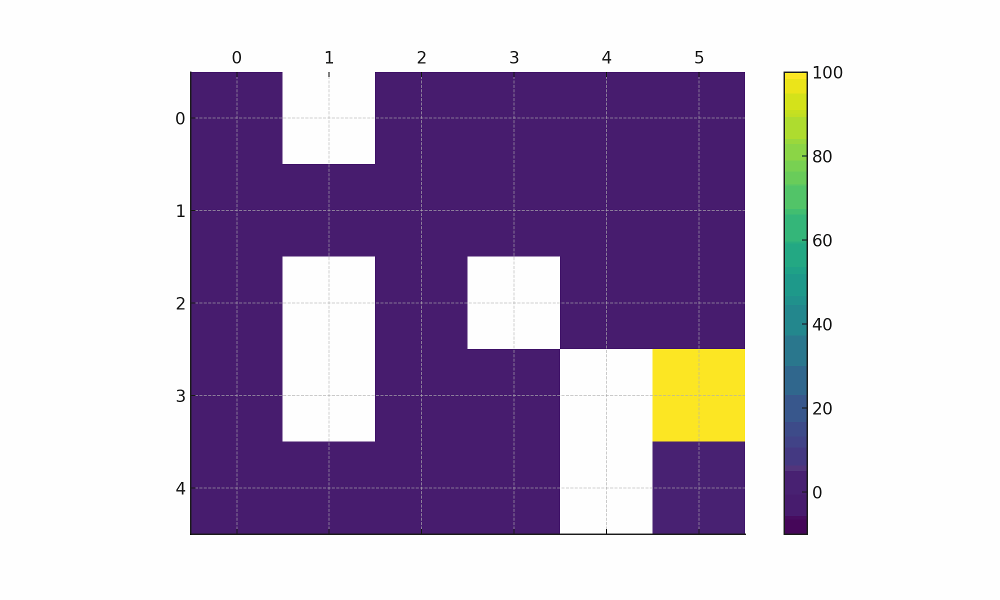

# MazeMDP

Finding the shortest path through a grid maze by modelling it as a **Markov Decision Process (MDP)** and solving it with **Value Iteration**.

Built for Assignment 3 (Non-Deterministic AI Application) in the DSCM046 Artificial Intelligence course at New Bulgarian University. The full write-up is in [`Assignment3-Nevena-Angelova.pdf`](Assignment3-Nevena-Angelova.pdf).



## Problem

Given a 5 × 6 maze, find the shortest path from the start cell **(0, 0)** to the goal cell **(4, 5)**.

- Allowed moves: **Up**, **Down**, **Left**, **Right**
- The outer boundary is a wall
- Some cells are obstacles that cannot be entered

```
  0 1 2 3 4 5
0 S █ . . . .
1 . . . . . .
2 . █ . █ . .
3 . █ . . █ .
4 . . . . █ G
```

## Approach

Each cell is a state, and the moves are the actions. State values are updated with the Bellman equation:

```
V(s) = max_a [ R(s, a) + γ · V(s') ]
```

| Parameter | Value |
|---|---|
| Reward per move | −1 |
| Obstacle value | −100 |
| Goal value | +100 |
| Discount factor γ | 0.9 |
| Convergence threshold θ | 0.01 |
| Max iterations | 50 |

If a move would hit a wall or an obstacle, the agent stays where it is. `value_iteration()` sweeps over the grid until the largest change in any value drops below θ, then returns the best action for each cell. `extract_path()` follows those actions from the start to the goal. It stops if a cell has no action or if the path starts looping.

## Getting started

Requires Python 3 with NumPy and Matplotlib:

```bash
pip install numpy matplotlib
```

```bash
python3 maze.py
```

## Output

The script prints the policy grid (an empty string marks an obstacle or the goal):

```
[['D', '',  'D', 'D', 'D', 'D'],
 ['R', 'R', 'R', 'R', 'D', 'D'],
 ['U', '',  'U', '',  'R', 'D'],
 ['U', '',  'U', 'L', '',  'D'],
 ['U', 'R', 'U', 'U', '',  '' ]]
```

It then prints the shortest path, 9 moves long:

```
[(0, 0), (1, 0), (1, 1), (1, 2), (1, 3), (1, 4), (2, 4), (2, 5), (3, 5), (4, 5)]
```

Finally, it opens a Matplotlib window that draws the path on the maze.

## Customising the maze

Edit `maze_map` in [`maze.py`](maze.py): `0` is a free cell and `1` is an obstacle. If you change the grid size or move the goal, update these too:

- `ROWS` and `COLS`
- `maze[4][5]`, which sets the goal cell
- the goal coordinate in `extract_path()`
- the call to `visualize_maze()`
